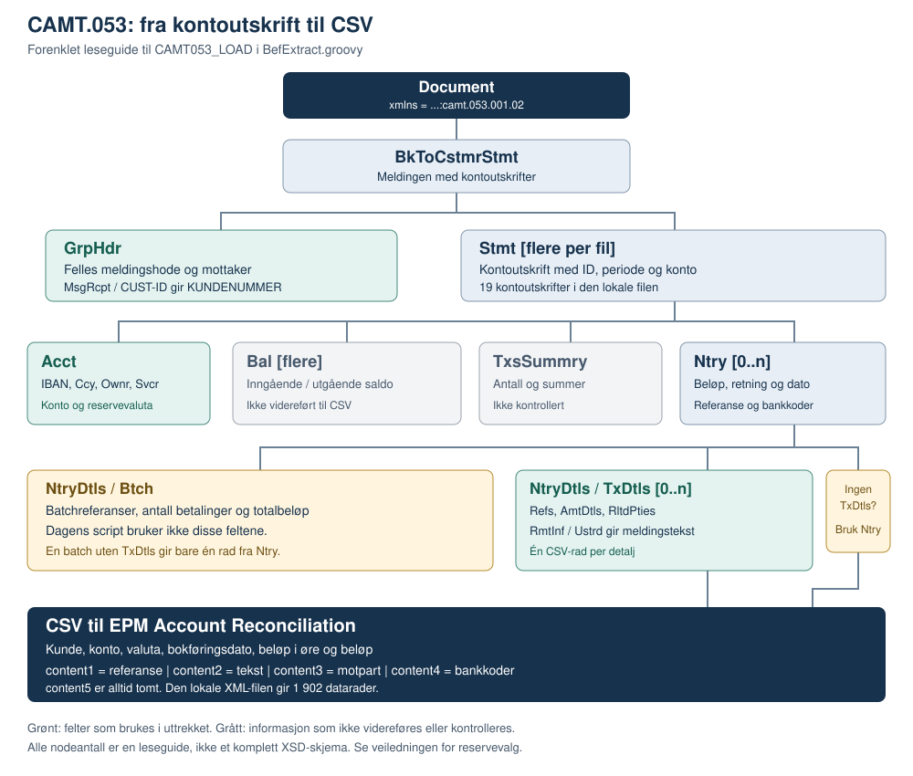

# CAMT.053 – fra XML til avstemmingsdata

Denne veiledningen forklarer feltene i `camt53.xml` og hvordan `CAMT053_LOAD` i `BefExtract.groovy` gjør dem om til CSV for Oracle EPM Account Reconciliation. **XML-en inneholder mer informasjon enn scriptet viderefører.** Saldoer, summer, KID-lignende strukturerte referanser og batchinformasjon blir ikke egne CSV-felter.

Veiledningen beskriver dagens kode, ikke alle muligheter i ISO 20022. Eksempelfilene bruker oppdiktede data og er ikke bankgodkjente testfiler. Produksjonskoden og den opprinnelige XML-filen er ikke endret.

## 1. Hva slags fil er dette?

CAMT.053 er en kontoutskrift fra bank til kunde. Filen her bruker meldingsversjonen `camt.053.001.02`, kalt `BankToCustomerStatementV02`.

| Nivå | Betydning |
|---|---|
| `Document` | Hele XML-dokumentet. `xmlns` angir meldingsformat og versjon. |
| `BkToCstmrStmt` | Selve meldingen med kontoutskrifter. |
| `GrpHdr` | Felles meldingsinformasjon: meldings-ID, opprettelsestid og mottaker. |
| `Stmt` | Én kontoutskrift med konto, periode, saldoer og posteringer. Samme fil kan ha flere utskrifter. |
| `Ntry` | Én postering på kontoen. Kan gjelde én betaling eller en samlepostering. |
| `NtryDtls/TxDtls` | Detaljer om betalingene bak posteringen. Kan mangle eller forekomme flere ganger. |

I den lokale `camt53.xml` finnes **19 kontoutskrifter, 1 849 posteringer og 1 266 transaksjonsdetaljer**. Seks utskrifter har ingen posteringer. Av posteringene har 636 ingen `TxDtls`; disse har batchinformasjon i `Btch`.

Scriptets radregel gir **1 902 datarader**: 1 266 rader fra `TxDtls` og 636 rader fra posteringer uten detaljer. Header kommer i tillegg. Antall CSV-rader er derfor verken antall `Ntry` eller summen av alle `Btch/NbOfTxs`.

## 2. Figur og filstruktur



Figuren er forenklet. `0..n` betyr at en node kan mangle eller gjentas. Det er en leseguide til denne integrasjonen, ikke en fullstendig angivelse av obligatoriske felter i XSD-skjemaet.

```text
Document [xmlns = ...:camt.053.001.02]
└─ BkToCstmrStmt
   ├─ GrpHdr
   │  ├─ MsgId, CreDtTm
   │  └─ MsgRcpt
   │     ├─ Nm
   │     └─ Id/OrgId/Othr [flere ID-er med ulike skjema]
   │        ├─ Id
   │        └─ SchmeNm/Cd [f.eks. CUST eller BANK]
   └─ Stmt [gjentas per kontoutskrift]
      ├─ Id, ElctrncSeqNb, LglSeqNb, CreDtTm
      ├─ FrToDt → FrDtTm, ToDtTm
      ├─ Acct → Id/IBAN, Ccy, Ownr, Svcr
      ├─ Bal [saldoer, f.eks. OPBD og CLBD]
      ├─ TxsSummry [antall og summer]
      └─ Ntry [gjentas per postering]
         ├─ NtryRef, Amt[@Ccy], CdtDbtInd, RvslInd, Sts
         ├─ BookgDt/Dt, ValDt/Dt, AcctSvcrRef
         ├─ BkTxCd → Domn, Prtry
         └─ NtryDtls
            ├─ Btch [batchinformasjon når oppgitt]
            └─ TxDtls [0..n]
               ├─ Refs [betalingsreferanser]
               ├─ AmtDtls [beløp og eventuell valutakurs]
               ├─ RltdPties [betaler, mottaker og kontoer]
               ├─ RltdAgts [bankene til partene]
               ├─ RmtInf → Ustrd og/eller Strd
               ├─ RltdDts [datoer]
               └─ Purp [betalingsformål når oppgitt]
```

### Slik leser du XML-stiene

Resten av veiledningen bruker disse forkortelsene:

| Prefiks | Full sti |
|---|---|
| `H` | `Document/BkToCstmrStmt/GrpHdr` |
| `S` | `Document/BkToCstmrStmt/Stmt` – den aktuelle kontoutskriften |
| `N` | `S/Ntry` – den aktuelle posteringen |
| `T` | `N/NtryDtls/TxDtls` – den aktuelle transaksjonsdetaljen |

`/` betyr «inne i». `@Ccy` er et attributt, ikke en egen tagg. I `<Amt Ccy="NOK">1250.50</Amt>` er beløpet `1250.50`, mens valutaen er `NOK`.

Taggnavn er ikke entydige uten sti: `S/Id` identifiserer utskriften, mens `S/Acct/Id/IBAN` identifiserer kontoen. Tilsvarende er `N/Amt` posteringens beløp, mens `T/AmtDtls/TxAmt/Amt` gjelder én betalingsdetalj.

## 3. Hvilke XML-felter blir hvilke CSV-kolonner?

CSV-filen har 11 kolonner i denne rekkefølgen:

```csv
KUNDENUMMER,ACCOUNTNUMBER,VALKODE,BDATE,BELOP_ORE,BELOP,content1,content2,content3,content4,content5
```

I tabellen betyr «ellers» at scriptet velger neste verdi hvis den foregående er tom etter trimming.

| CSV-kolonne | XML-kilde og regel | Eksempel |
|---|---|---|
| `KUNDENUMMER` | `H/MsgRcpt/Id/OrgId/Othr/Id` der tilhørende `SchmeNm/Cd` er `CUST`. Ellers første `Othr/Id` hos kontoeieren i filens første `Stmt`. | `00000000000` |
| `ACCOUNTNUMBER` | `S/Acct/Id/IBAN`, ellers `S/Acct/Id/Othr/Id`. Mellomrom fjernes. For norsk IBAN fjernes de fire første tegnene (`NO` og kontrollsifrene). | `NO0011111111111` → `11111111111` |
| `VALKODE` | `T/AmtDtls/TxAmt/Amt/@Ccy`, ellers `N/Amt/@Ccy`, ellers `S/Acct/Ccy`, ellers `NOK`. Uten `TxDtls` begynner valget på `N/Amt/@Ccy`. | `NOK` |
| `BDATE` | Bare `N/BookgDt/Dt`, formatert fra `yyyy-MM-dd` til `dd-MMM-yy` med engelsk månedsnavn. | `2026-06-03` → `03-Jun-26` |
| `BELOP_ORE` | Det ferdig fortegnede og avrundede `BELOP` ganget med 100, uten desimaler. | `-200.25` → `-20025` |
| `BELOP` | `T/AmtDtls/TxAmt/Amt`, ellers `N/Amt`. Fortegn bestemmes av `N/CdtDbtInd`. To desimaler med `HALF_UP`-avrunding. | `200.25` + `DBIT` → `-200.25` |
| `content1` | Første tilgjengelige referanse etter prioriteten i avsnitt 4. Egen regel for teksten `OVERF. NORGES BANK`. Uten detaljer: `N/NtryRef`, ellers `N/AcctSvcrRef`. | `DEMO-CLR-001` |
| `content2` | Sammenslått `T/RmtInf/Ustrd`. Hvis resultatet er tomt, brukes `T/AddtlTxInf`. Uten detaljer: tomt. | `Faktura DEMO-1001` |
| `content3` | Motpartens navn fra `T/RltdPties`, valgt etter debet/kredit. Uten detaljer: tomt. | `Eksempel betaler AS` |
| `content4` | Bankkode satt sammen av `N/BkTxCd` og retningen. Se avsnitt 4. | `Innbetaling/PMNT/RCDT/DMCT/CRDT` |
| `content5` | Alltid tomt i denne CAMT.053-implementasjonen. | Tomt siste felt |

**Viktig navneavvik:** Hjelpefunksjonen heter `buildBankContent5`, men resultatet står på plass 10 i raden, altså i **`content4`**. Tabellen og eksemplene følger den faktiske kolonnerekkefølgen.

`KUNDENUMMER` beregnes én gang per fil og gjenbrukes på alle rader. Det er ikke kundens eller motpartens ID per transaksjon. Reserveløsningen leser kontoeieren i første utskrift, ikke eieren i hver enkelt utskrift.

## 4. Valgregler som påvirker resultatet

### Referansen i `content1`

Når `TxDtls` finnes, velges første ikke-tomme verdi i denne rekkefølgen:

1. `T/Refs/ClrSysRef` – referanse fra clearing-/avregningssystemet.
2. `T/Refs/EndToEndId` – ende-til-ende-referanse for betalingen.
3. `T/Refs/TxId` – transaksjons-ID.
4. `T/Refs/AcctSvcrRef` – kontoførende banks referanse på detaljnivå.
5. `N/AcctSvcrRef` – bankens referanse på posteringsnivå.
6. `N/NtryRef` – posteringens referanse.

Disse referansene kan ha forskjellige verdier for samme betaling. At `EndToEndId` finnes i XML-en, betyr derfor ikke at den kommer i CSV-en; en utfylt `ClrSysRef` velges først.

Hvis den ferdigbehandlede meldingsteksten er nøyaktig `OVERF. NORGES BANK`, erstattes hele referansesøket med **betalers konto**: `T/RltdPties/DbtrAcct/Id/IBAN`, ellers `.../Othr/Id`. Kontoen normaliseres på samme måte som `ACCOUNTNUMBER`. Mangler kontoen, blir `content1` tomt; scriptet går da ikke tilbake til referansene. Sammenligningen skiller mellom store og små bokstaver.

### Meldingsteksten i `content2`

Scriptet leser alle `T/RmtInf/Ustrd` i dokumentrekkefølge. Det fjerner bare **like linjer som står rett etter hverandre**, slår deretter sammen tekstene **uten å sette inn mellomrom**, og samler eksisterende whitespace til ett mellomrom.

| Innhold i separate `Ustrd`-tagger | Resultat |
|---|---|
| `ABC`, `ABC`, `DEF` | `ABCDEF` |
| `ABC`, `DEF`, `ABC` | `ABCDEFABC` |
| `Faktura `, `1001` | `Faktura 1001` |
| Ingen `Ustrd`, men `AddtlTxInf = Ekstra tekst` | `Ekstra tekst` |

`RmtInf/Strd` er strukturert betalingsinformasjon. Scriptet leser **ikke** denne grenen, heller ikke `CdtrRefInf/Ref`. En strukturert betalingsreferanse eller fakturareferanse kan derfor finnes i XML-en samtidig som `content2` blir tomt.

### Motpart i `content3`

`Dbtr` betyr betaler/debitor og `Cdtr` betyr mottaker/kreditor. Navnene beskriver partene i betalingen, ikke nødvendigvis hvem som eier utskriftskontoen.

| Retning fra `N/CdtDbtInd` | Prioritet for navn |
|---|---|
| `DBIT` – belastning av utskriftskontoen | `T/RltdPties/Cdtr/Nm`, deretter `UltmtCdtr/Nm`, deretter `Dbtr/Nm` |
| `CRDT` – godskriving av utskriftskontoen | `T/RltdPties/Dbtr/Nm`, deretter `UltmtDbtr/Nm`, deretter `Cdtr/Nm` |

`UltmtDbtr` og `UltmtCdtr` er den endelige betaleren eller mottakeren når slike parter er oppgitt. Scriptet bruker kredit-prioriteten for alle andre retningsverdier enn nøyaktig `DBIT`.

### Bankkoder i `content4`

Scriptet slår sammen følgende verdier med `/` og hopper over tomme deler:

```text
N/BkTxCd/Prtry/Cd
N/BkTxCd/Domn/Cd
N/BkTxCd/Domn/Fmly/Cd
N/BkTxCd/Domn/Fmly/SubFmlyCd
N/CdtDbtInd [eller standardverdien CRDT]
```

`Prtry/Cd` er bankens egen kode eller beskrivelse. `Domn` er en hierarkisk standardkode: domene, familie og underfamilie. `PMNT` angir betalinger; `RCDT` mottatte kredittoverføringer og `ICDT` initierte kredittoverføringer. Underfamilien presiserer betalingstypen, for eksempel `DMCT` for innenlandsk kredittoverføring. Koden beskriver type, mens `CdtDbtInd` angir retning på kontoen.

Den lokale filen inneholder også underfamiliene `RRTN`, `OTHR`, `VCOM`, `XBCT`, `ESCT` og `SALA`. Scriptet tolker ikke disse kodene videre; det kopierer dem til `content4`. Bankspesifikke tolkninger må avklares mot bankens formatbeskrivelse og riktig versjon av kodeverket.

### Beløp, dato og CSV-format

`CRDT` gir normalt positivt beløp. `DBIT` gjør et positivt kildebeløp negativt; et allerede negativt beløp forblir negativt. Scriptet bruker ikke absoluttverdi for `CRDT`. `RvslInd` påvirker ikke fortegnet.

Beløp avrundes til to desimaler før øreverdien beregnes: `12.345` blir `12.35` og `1235` øre. Desimalskilletegn i CSV er punktum, mens feltskillet er komma. Beløps- og valutafelt velges hver for seg; scriptet utfører ikke valutakonvertering eller kontroll av at valutaene stemmer overens.

Manglende retning får verdien `CRDT`. Manglende dato eller beløp blir tomt. Et beløp som ikke kan tolkes, gir en advarsel og teksten videreføres med komma erstattet av punktum. En dato som gir en parse-feil, gir en advarsel og videreføres uendret. Datoparseren er ikke strengt validerende, og kan normalisere enkelte ugyldige datoer. `BookgDt/DtTm` er ikke en reserve for `BookgDt/Dt`.

CSV-felter med komma, linjeskift eller anførselstegn omsluttes av `"`. Interne anførselstegn dobles. Tom `content5` vises som et avsluttende komma. CAMT.053-regelen skriver UTF-8, selv om scriptets globale standardencoding er en annen.

## 5. Andre tagger i XML-en – og hva som ikke lastes inn

Tabellene dekker de øvrige faglige feltene i den lokale XML-en. Mellomliggende containere grupperer feltene; de gir ikke egne verdier i CSV.

### Meldingshode, konto og periode

| XML-sti | Hva dataene beskriver | Bruk i dagens CSV |
|---|---|---|
| `Document/@xmlns` | ISO 20022-meldingsversjonen. | Inngår i gjenkjenning av filtypen; ingen egen kolonne. |
| `H/MsgId`, `H/CreDtTm` | Meldings-ID og tidspunkt for opprettelse av meldingen. | Ikke videreført. |
| `H/MsgRcpt/Nm` | Navn på meldingsmottakeren. | Ikke videreført. |
| `H/MsgRcpt/Id/OrgId/Othr/SchmeNm/Cd` | Hvilken type identifikator den tilhørende `Id` er. | `CUST` brukes som filter for `KUNDENUMMER`; `BANK`-ID-en brukes ikke. |
| `S/Id`, `S/ElctrncSeqNb`, `S/LglSeqNb` | Utskrifts-ID, elektronisk og juridisk sekvensnummer. | Ikke videreført; må ikke forveksles med `NtryRef`. |
| `S/CreDtTm` | Når kontoutskriften ble opprettet. | Ikke brukt som bokføringsdato. |
| `S/FrToDt/FrDtTm`, `S/FrToDt/ToDtTm` | Periodens start og slutt. | Ikke videreført. |
| `S/Acct/Ownr/Nm` | Kontoeierens navn. | Ikke brukt som motpartsnavn. |
| `S/Acct/Ownr/Id/OrgId/Othr/Id` | Kontoeierens identifikator. | Bare reserve for `KUNDENUMMER`, fra første utskrift. |
| `S/Acct/Ownr/Id/OrgId/Othr/SchmeNm/Cd` | Type kontoeier-ID. | Ikke filtrert i reserveløsningen. |
| `S/Acct/Svcr/FinInstnId/BIC` | Bankens BIC for utskriftskontoen. | Ikke videreført. |

### Saldoer og summer

| XML-sti | Hva dataene beskriver | Bruk i dagens CSV |
|---|---|---|
| `S/Bal/Tp/CdOrPrtry/Cd` | Saldoens type. `OPBD` er inngående bokført saldo; `CLBD` er utgående bokført saldo. | Ingen saldorader opprettes. |
| `S/Bal/Amt`, `S/Bal/Amt/@Ccy` | Saldobeløp og valuta. | Ikke videreført. |
| `S/Bal/CdtDbtInd` | Om saldoen er kredit eller debet. | Ikke brukt for transaksjonsfortegn. |
| `S/Bal/Dt/Dt` | Datoen saldoen gjelder. | Ikke videreført. |
| `S/Bal/CdtLine/Incl` | Om kredittfasilitet er inkludert i saldoen. | Ikke videreført. |
| `S/TxsSummry/TtlNtries/NbOfNtries` | Antall posteringer i utskriften. | Ikke kontrollert mot genererte rader. |
| `S/TxsSummry/TtlNtries/TtlNetNtryAmt` og `CdtDbtInd` | Nettobeløp og retning for posteringene samlet. | Ikke videreført eller avstemt. |
| `S/TxsSummry/TtlCdtNtries/NbOfNtries` og `Sum` | Antall og sum for kreditposteringer. | Ikke videreført eller avstemt. |
| `S/TxsSummry/TtlDbtNtries/NbOfNtries` og `Sum` | Antall og sum for debetposteringer. | Ikke videreført eller avstemt. |

### Postering, batch og transaksjonsdetaljer

| XML-sti | Hva dataene beskriver | Bruk i dagens CSV |
|---|---|---|
| `N/RvslInd` | Om posteringen er en reversering. | Ingen egen reverseringslogikk. |
| `N/Sts` | Posteringsstatus; `BOOK` betyr bokført. | Scriptet filtrerer ikke på status. |
| `N/ValDt/Dt` | Valuteringsdato, altså datoen beløpet gjelder for renteberegning. | Ikke brukt i `BDATE`. |
| `N/BkTxCd/Prtry/Issr` | Utsteder av den bankspesifikke koden. | Ikke tatt med i kodefeltet. |
| `N/NtryDtls/Btch/MsgId`, `PmtInfId` | Referanser til melding og betalingsgruppe i batchen. | Ikke brukt som `content1`. |
| `N/NtryDtls/Btch/NbOfTxs` | Antall betalinger i batchen. | Batchen deles ikke i dette antallet CSV-rader. |
| `N/NtryDtls/Btch/TtlAmt`, `CdtDbtInd` | Batchens totalbeløp og retning. | Ikke lest; scriptet bruker `N/Amt` og `N/CdtDbtInd` når detaljer mangler. |
| `T/Refs/MsgId`, `PmtInfId`, `InstrId` | Opprinnelig meldingsreferanse, betalingsgruppe og instruksjons-ID. | Ikke med i referanseprioriteten. |
| `T/AmtDtls/InstdAmt/Amt` og `@Ccy` | Instruert beløp og valuta, som kan avvike fra kontobeløpet. | Ikke brukt som `BELOP` eller `VALKODE`. |
| `T/AmtDtls/PrtryAmt/Tp`, `Amt` og `Amt/@Ccy` | Bankspesifisert beløpstype, beløp og valuta. | Ikke videreført. |
| `T/AmtDtls/InstdAmt/CcyXchg/*` og `PrtryAmt/CcyXchg/*` | `SrcCcy`, `TrgtCcy` og `XchgRate`: kildevaluta, målvaluta og kurs. | Ingen kursberegning i scriptet. |
| `T/RltdPties/DbtrAcct/Id/*` | Betalers konto; `IBAN` eller `Othr/Id`. `Othr/SchmeNm/Cd` kan være `BBAN` for nasjonalt kontonummer. | Bare kontoverdien brukes ved Norges Bank-spesialregelen. |
| `T/RltdPties/DbtrAcct/Ccy` | Valuta for betalers konto. | Ikke brukt som `VALKODE`. |
| `T/RltdPties/CdtrAcct/Id/*` | Mottakers konto og eventuelt kontoskjema. | Ikke videreført, heller ikke ved `DBIT`. |
| `T/RltdPties/Dbtr/PstlAdr/*` og `Cdtr/PstlAdr/*` | Adressefeltene `StrtNm`, `PstCd`, `TwnNm`, `Ctry`, `CtrySubDvsn` og frie `AdrLine`. | Ikke videreført. |
| `T/RltdAgts/DbtrAgt/FinInstnId/*` og `CdtrAgt/FinInstnId/*` | Partenes banker: BIC, navn og eventuell adresse i `PstlAdr/AdrLine`. | Ikke videreført. |
| `T/RltdDts/IntrBkSttlmDt` | Oppgjørsdato mellom banker. | Ikke brukt i `BDATE`. |
| `T/RltdDts/AccptncDtTm` | Tidspunkt for aksept av betalingen. | Ikke videreført. |
| `T/Purp/Cd`, `T/Purp/Prtry` | Standardisert eller bankspesifikt betalingsformål. | Ikke videreført. |

### Strukturert betalingsinformasjon

Alle feltene under ligger i `T/RmtInf/Strd` og blir **ikke lest** av dagens uttrekk:

| Understi | Hva dataene beskriver |
|---|---|
| `RfrdDocInf/Tp/CdOrPrtry/Cd` | Type referert dokument, for eksempel en faktura. |
| `RfrdDocInf/Nb` | Dokumentnummer, for eksempel fakturanummer. |
| `RfrdDocInf/RltdDt` | Dato knyttet til dokumentet. |
| `RfrdDocAmt/RmtdAmt` og `@Ccy` | Beløpet som betales for det refererte dokumentet, med valuta når oppgitt. |
| `RfrdDocAmt/CdtNoteAmt` og `@Ccy` | Kreditnotabeløp, med valuta når oppgitt. |
| `CdtrRefInf/Tp/CdOrPrtry/Cd` | Type mottakerreferanse. I den lokale filen brukes `SCOR`. |
| `CdtrRefInf/Ref` | Strukturert mottakerreferanse; kan være KID eller annen betalingsreferanse avhengig av bankens profil. `SCOR` alene betyr ikke at verdien nødvendigvis er norsk KID. |

## 6. Fra posteringer til CSV-rader

Når en `Ntry` har én eller flere `TxDtls`, lager scriptet én rad per detalj. Det oppretter ikke en ekstra totalrad for `Ntry`.

Hvis detaljbeløpet mangler, brukes **hele posteringens beløp som reserve for den detaljen**. Ved flere detaljer kan det derfor bli gjentatte totalbeløp. Scriptet kontrollerer ikke at summen av detaljene er lik posteringens beløp.

Når `TxDtls` mangler, lager scriptet én rad fra selve `Ntry`. `content2` og `content3` blir tomme. Eventuell `Btch` gir ikke ekstra rader eller ekstra tekst. En utskrift med bare saldoer og ingen `Ntry` gir ingen datarader.

For den lokale filen har fem posteringer flere detaljer: henholdsvis 8, 9, 6, 2 og 33. De øvrige posteringene med detaljer har én hver. Dette forklarer hvorfor radantallet blir større enn antallet posteringer.

## 7. Eksempel på XML og faktisk output

Komplett, oppdiktet input ligger i [eksempler/camt053-eksempel.xml](eksempler/camt053-eksempel.xml). Forventet CSV ligger i [eksempler/camt053-eksempel.csv](eksempler/camt053-eksempel.csv). XML-en illustrerer feltene scriptet leser; den er ikke validert mot bankens XSD/profil. Kontonumre og kunde-ID er plassholdere uten gyldighetsgaranti.

### Eksempel A – innbetaling med fritekst

Denne posteringen bruker én detalj med beløp, referanse, navn og melding:

```xml
<Ntry>
  <NtryRef>DEMO-NTRY-001</NtryRef>
  <Amt Ccy="NOK">1250.50</Amt>
  <CdtDbtInd>CRDT</CdtDbtInd>
  <BookgDt><Dt>2026-06-03</Dt></BookgDt>
  <NtryDtls>
    <TxDtls>
      <Refs>
        <ClrSysRef>DEMO-CLR-001</ClrSysRef>
        <EndToEndId>DEMO-E2E-001</EndToEndId>
      </Refs>
      <AmtDtls><TxAmt><Amt Ccy="NOK">1250.50</Amt></TxAmt></AmtDtls>
      <RltdPties><Dbtr><Nm>Eksempel betaler AS</Nm></Dbtr></RltdPties>
      <RmtInf><Ustrd>Faktura DEMO-1001</Ustrd></RmtInf>
    </TxDtls>
  </NtryDtls>
</Ntry>
```

Utdraget utelater bankkodene; de finnes i den komplette eksempelfilen. `ClrSysRef` velges foran `EndToEndId`. Beløpet er positivt, og betalers navn blir motpart.

### Eksempel B – utbetaling med to detaljer og strukturert referanse

En postering på `300.00` med `DBIT` har to detaljer på `200.25` og `99.75`. Den gir to rader: `-200.25` og `-99.75`. Begge får bokføringsdatoen fra den felles posteringen.

Første detalj har `RmtInf/Strd/CdtrRefInf/Ref = DEMO-STRUKTURERT-001`, men ingen `Ustrd` eller `AddtlTxInf`. `content2` blir derfor tomt. `content1` kommer fra `Refs/EndToEndId`, ikke fra den strukturerte referansen.

### Eksempel C – batch uten detaljer

En postering på `500.00` med `DBIT` og `Btch/NbOfTxs = 3`, men uten `TxDtls`, gir **én rad på `-500.00`**, ikke tre rader. `content1` blir `NtryRef`. Navn og melding blir tomme.

### Eksempel D – overføring til Norges Bank

Når `Ustrd` er `OVERF. NORGES BANK`, får `content1` betalers normaliserte konto `22222222222`. En utfylt `ClrSysRef` blir ikke brukt i dette tilfellet.

### Samlet CSV fra de fire posteringene

```csv
KUNDENUMMER,ACCOUNTNUMBER,VALKODE,BDATE,BELOP_ORE,BELOP,content1,content2,content3,content4,content5
00000000000,11111111111,NOK,03-Jun-26,125050,1250.50,DEMO-CLR-001,Faktura DEMO-1001,Eksempel betaler AS,Innbetaling/PMNT/RCDT/DMCT/CRDT,
00000000000,11111111111,NOK,03-Jun-26,-20025,-200.25,DEMO-E2E-002,,Eksempel leverandor AS,Utbetaling/PMNT/ICDT/DMCT/DBIT,
00000000000,11111111111,NOK,03-Jun-26,-9975,-99.75,DEMO-TX-003,,Eksempel mottaker AS,Utbetaling/PMNT/ICDT/DMCT/DBIT,
00000000000,11111111111,NOK,03-Jun-26,-50000,-500.00,DEMO-NTRY-003,,,Samlebetaling/PMNT/ICDT/SALA/DBIT,
00000000000,11111111111,NOK,03-Jun-26,-200000,-2000.00,22222222222,OVERF. NORGES BANK,Norges Bank,Overforing/PMNT/ICDT/DMCT/DBIT,
```

De lange CSV-linjene er også tilgjengelige i eksempelfilen uten visuell linjebryting. Fire posteringer gir fem datarader fordi postering B har to detaljer.

## 8. Innlesing og viktige avgrensninger

`CAMT053_LOAD` leter i `inbox/bank/camt053/` under miljøroten `/data/ar/dev` eller `/data/ar/prod`. Den velger filer med `.xml`-endelse der de første 60 linjene inneholder `camt.053`, uten hensyn til store og små bokstaver. Flere filer slås sammen med én header. Filene sorteres etter endringstid og deretter navn.

Filgjenkjenning er ikke skjemavalidering. Dagens parser er satt opp uten namespace-behandling og bruker uprefikserte taggnavn. Den lokale filen og eksempelfilen har et standardnamespace uten prefiks. En semantisk tilsvarende fil med navn som `ns:Document` og `ns:BkToCstmrStmt` er ikke dokumentert som støttet av disse taggoppslagene. Andre CAMT.053-versjoner kan gjenkjennes uten at feltene nødvendigvis leses riktig.

Kilden kopieres til `inbox/bank/camt053/arkiv/` og originalen forsøkes slettet etter at den er transformert. Den samlede outputfilen skrives **etter** denne arkiveringen. Manglende filer gir bare header og en advarsel. En manglende inputmappe gir header og feil.

Før dataene brukes til avstemming, bør du særlig kontrollere at:

- nødvendige betalingsreferanser faktisk finnes i `content1` eller `content2`, ikke bare i `RmtInf/Strd`;
- batcher uten detaljer har riktig detaljnivå for avstemmingen;
- detaljbeløp og valuta er utfylt, slik at reserveverdier ikke skjuler avvik;
- det ikke forventes automatisk kontroll av saldoer, statuser eller summer – scriptet utfører ingen slik kontroll.

## 9. Kildegrunnlag

Feltkoblingene er lest fra disse delene av [BefExtract.groovy](../BefExtract.groovy):

| Funksjon eller område | Hva det dokumenterer |
|---|---|
| `isCamt053File` og `readFilePreview` | Gjenkjenning av XML-filer. |
| `buildCamt053Output` | Kolonnerekkefølge, XML-stier, referansevalg, meldingstekst og radregel. |
| `findCounterpartyName`, `extractRelatedAccount` | Valg av motpart og Norges Bank-konto. |
| `buildBankContent5` | Sammensetting av kodene som faktisk havner i `content4`. |
| `formatCamtDate`, `formatSignedAmount`, `toOreAmount` | Dato, fortegn, avrunding og ørebeløp. |
| `normalizeAccountNumber`, `firstNonBlank`, `collapseWhitespace`, `escapeCsvValue` | Normalisering, reservevalg og CSV-escaping. |
| `ruleHandlers["CAMT053_LOAD"]` | Inputmappe, flere filer, UTF-8-output og arkivering. |

Struktur og tellinger gjelder den lokale `camt53.xml` som fulgte oppgaven. Andre XML-filer under for eksempel `.idea/` er IDE-konfigurasjon og inngår ikke i CAMT.053-flyten. For normativ feltdefinisjon, obligatoriske felter og gyldige kodeverdier gjelder [ISO 20022s meldingskatalog](https://www.iso20022.org/iso-20022-message-definitions), [eksterne kodeverk](https://www.iso20022.org/catalogue-messages/additional-content-messages/external-code-sets) og bankens implementasjonsbeskrivelse for aktuell versjon.
